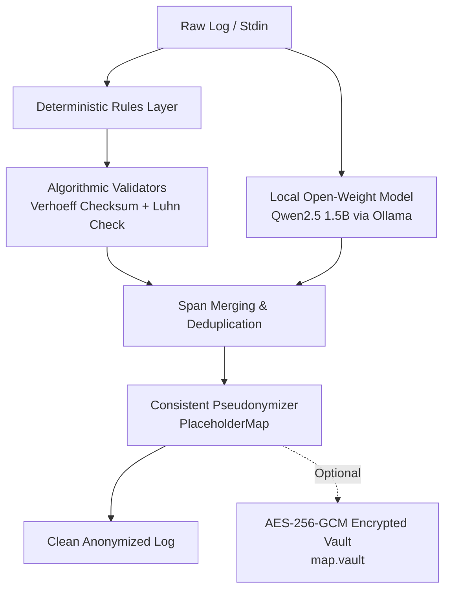

# ScrubIN: scrub PII from logs and tickets, locally

[](https://github.com/mansikardile/scrubin/actions/workflows/ci.yml)
[](LICENSE)
[](https://hacktoberfest.com)
[](https://www.python.org/downloads/)

Paste logs into Slack, vendor portals, or cloud LLMs without leaking sensitive data.
Combines deterministic rules + algorithmic checksum validators + local open-weight models (`Qwen2.5 1.5B` via Ollama) running 100% on your machine. **Zero telemetry. Zero cloud calls.**

---

## ⚡ Why AI Matters: Rules vs. Hybrid Pipeline

Deterministic regular expressions are ultra-fast (~15,000 lines/sec) and catch structured identifiers (PAN, Aadhaar, emails, phones, tokens) with near-zero false alarms. But **rules alone cannot understand contextual free text**, such as Indian customer names and locations in support tickets:

| Text Fragment | Regex Rules Only | Hybrid: Rules + Qwen2.5 1.5B |
|---|---|---|
| `user Rohan Deshmukh (rohan.d@gmail.com)` | `user Rohan Deshmukh (<EMAIL_1>)` ❌ *Name leaked* | `user <PERSON_1> (<EMAIL_1>)` ✅ |
| `shipped to Kothrud, Pune` | `shipped to Kothrud, Pune` ❌ *Address leaked* | `shipped to <LOCATION_1>, Pune` ✅ |
| `PAN ABCDE1234F, Aadhaar 2345 6789 0124` | `PAN <PAN_1>, Aadhaar <AADHAAR_1>` ✅ | `PAN <PAN_1>, Aadhaar <AADHAAR_1>` ✅ |

```
Before: 2026-10-21 10:32:11 ERROR payment failed for user Rohan Deshmukh (rohan.d@gmail.com, +91 98765 43210), PAN ABCDE1234F, Aadhaar 2345 6789 0124, token=eyJhbGciOiJIUzI1NiIs.abc123def456.sig789xyz
After:  2026-10-21 10:32:11 ERROR payment failed for user <PERSON_1> (<EMAIL_1>, <PHONE_1>), PAN <PAN_1>, Aadhaar <AADHAAR_1>, token=<SECRET_1>
```

> Same person => same placeholder. `<PERSON_1> failed 3 times, then succeeded` remains fully debuggable without exposing real identities.

---

## 🏗️ Architecture



---

## 💻 Local Web UI Studio

ScrubIN includes a built-in, zero-dependency browser UI for live interactive testing:

```bash
scrubin ui
```
Opens `http://localhost:8765` with sample presets (banking, support, devops), live engine toggle, visual placeholder highlighting, and entity count badges.

---

## 📦 Installation

```bash
# Core + Local Model + Encrypted Vault support
pip install -e ".[model,vault]"

# Pull local open-weight model
ollama pull qwen2.5:1.5b
```

---

## 🚀 CLI Usage

```bash
# 1. Scrub a file with deterministic rules only (ultra-fast)
scrubin scrub examples/sample.log

# 2. Scrub with Hybrid pipeline (Rules + local Qwen2.5 1.5B)
scrubin scrub examples/sample.log --engine ollama

# 3. Pipe directly from kubectl or cat
kubectl logs mypod | scrubin scrub - | pbcopy

# 4. Save reversible encrypted vault mapping
scrubin scrub app.log --vault map.vault > clean.log

# 5. Restore original log from vault (requires password)
scrubin restore clean.log --vault map.vault
```

---

## 📊 Comprehensive Benchmark

Evaluated on 50 synthetic Indian logs across 8 distinct entity categories using `eval/evaluate.py`:

| Setup | Overall Recall | Overall Precision | Throughput |
|---|:---:|:---:|:---:|
| **Regex Only** | 67.9% | 96.0% | **~15,500 lines/sec** |
| **Hybrid (Regex + Qwen2.5 1.5B)** | **100.0%** | **94.6%** | local inference |

### Per-Entity Breakdown

| Entity Type | Count | Regex Recall | Hybrid (Rules + Qwen) Recall | Algorithmic Guard |
|---|:---:|:---:|:---:|---|
| **AADHAAR** | 8 | 100.0% | **100.0%** | Verhoeff Checksum validation |
| **CARD** | 9 | 100.0% | **100.0%** | Luhn Checksum validation |
| **EMAIL** | 15 | 100.0% | **100.0%** | RFC pattern validation |
| **IP (v4/v6)** | 12 | 100.0% | **100.0%** | Octet range validation |
| **PAN** | 5 | 100.0% | **100.0%** | 5-alpha + 4-digit + 1-alpha format |
| **PHONE** | 15 | 100.0% | **100.0%** | Indian mobile prefixes (`+91`, 6-9) |
| **SECRET** | 8 | 100.0% | **100.0%** | JWT (`eyJ...`) & AWS Access Keys |
| **PERSON** | 21 | 0.0% | **100.0%** | Contextual NER via Qwen2.5 |
| **LOCATION** | 13 | 0.0% | **100.0%** | Contextual NER via Qwen2.5 |

---

## 🔍 Model Licenses & Verification

- **Underlying Model**: [Qwen2.5-1.5B-Instruct](https://huggingface.co/Qwen/Qwen2.5-1.5B-Instruct) by Alibaba Cloud, released under the permissive [Apache 2.0 License](https://www.apache.org/licenses/LICENSE-2.0).
- **Automated Verification**: Run the automated test suite locally:
  ```bash
  pip install -e ".[dev]"
  pytest -q
  ```
- **Local Benchmark Reproduction**:
  ```bash
  python eval/evaluate.py --data eval/data.jsonl --ollama qwen2.5:1.5b --breakdown
  ```

---

## ⚠️ Honest Limitations
No scrubber is 100% foolproof. Deliberate obfuscation (e.g. `rohan [at] gmail dot com`), values split across line breaks, and ambiguous names that coincide with dictionary words can slip through. Always have human review for high-risk datasets.

---

## 🤝 Contributing
Contributions welcome! Check out our [good first issues](https://github.com/mansikardile/scrubin/issues) for Hacktoberfest. See [CONTRIBUTING.md](CONTRIBUTING.md) for details.

## 📄 License
[MIT](LICENSE)